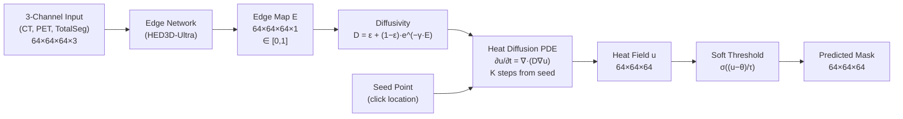

# Heat-GDT Model — MedEye3d Integration Guide

> **Purpose**: This document explains how to access, load, and run the Heat-GDT model (edge ML network + heat kernel PDE) so a MedEye3d developer can integrate it into the interactive annotation tool.

---

## 1. Architecture Overview

The Heat-GDT framework has **two components** that work in sequence:



### Component 1: Edge Network (ML — runs once per volume)
- **Input**: `(X, Y, Z, 3, 1)` Float32 tensor — 3 channels: normalized CT, raw PET SUV (optional), normalized TotalSegmentator atlas
- **Output**: `(X, Y, Z, 1, 1)` Float32 edge probability map ∈ [0, 1]
- **Architectures available**:
  - **HED3D-Ultra** (56.5M params) — ultra-wide variant (**default / recommended model**)
  - **HED3D-Wide** (31.8M params) — wider variant
  - **HED3D** (14.1M params) — standard variant

### Component 2: Heat Kernel PDE (pure math — runs per click)
- **Input**: edge map → diffusivity field `D`, seed point mask
- **Output**: heat field `u` → thresholded into binary mask
- **Key**: The diffusion time (number of steps `K`) controls how far the segmentation grows — this is what the user controls by mouse-button hold duration

---

## 2. Performance Results & Modality Support

The models have been thoroughly evaluated on 793 patches for both the standard dual-modality (PET/CT) and unimodal (Pure CT) configurations. 

> **Pretraining Note**: The `HED3D-Ultra` model was explicitly pretrained on organ boundary edges from TotalSegmentator before being fine-tuned end-to-end on lesions. This provides it with a strong structural boundary prior.

### 2.1 Multimodal (PET/CT) vs Unimodal (Pure CT)

| Model | Params | Modality | Best Dice | Optimal θ | Checkpoint |
|---|---|---|---|---|---|
| **HED3D-Ultra + pretrain** | 56.5M | PET/CT | 0.4190 | 0.001 | `champion_pretrained_hed3d_ultra.jld2` |
| **HED3D-Ultra + pretrain** | 56.5M | Pure CT | **0.3132** | 0.001 | `champion_pretrained_hed3d_ultra.jld2` |
| HED3D-Wide + pretrain | 31.8M | PET/CT | 0.4235 | 0.001 | `champion_pretrained_hed3d_wide.jld2` |
| HED3D-Wide + pretrain | 31.8M | Pure CT | 0.3048 | 0.001 | `champion_pretrained_hed3d_wide.jld2` |

> [!TIP]
> **Modality Strategy**: The massive 56.5M parameter **HED3D-Ultra** is the absolute best model for pure CT, as the extra capacity helps extract structural boundaries when PET intensity is missing. For PET/CT, it converges near the same limit (~0.42 Dice), making it the single recommended model for both modes.

### 2.2 Recommended Configuration

For **MedEye3d integration**, we recommend:

- **Checkpoint**: `champion_pretrained_hed3d_ultra.jld2`
- **Architecture**: `HED3D-Ultra` (56.5M params)
- **Threshold**: θ=0.001 (default) with optional user slider for fine-tuning

---

## 3. Minimal Inference Code

### 3.1 Load Model + Weights

```julia
using Lux, CUDA, LuxCUDA, ComponentArrays, JLD2, NNlib

# Load HED3D-Ultra
include("architectures/hed3d_ultra.jl")
edge_net = HED3D_Ultra(3)                # 3 input channels
ckpt = JLD2.load("champion_pretrained_hed3d_ultra.jld2")

ps_gpu = ckpt["ps"].edge_net |> gpu
st_gpu = ckpt["st"].edge_net |> gpu
st_gpu = Lux.testmode(st_gpu)            # CRITICAL: Disable BatchNorm updates
```

### 3.2 Run Edge Network (Once per Session/Patch)

```julia
# Assume x is your (64,64,64,3,1) Float32 input tensor on GPU
edge_map, _ = edge_net(x, ps_gpu, st_gpu)
```

### 3.3 Compute Diffusivity (Once after Edge Network)

```julia
# D = ε + (1-ε) * exp(-γ * edge_map)
# Default values for standard PET/CT: epsilon_D=0.01f0, gamma=5.0f0
# Tuned values for strictly enforcing CT tissue borders (preventing heat leakage): epsilon_D=0.0001f0, gamma=2.5f0
function compute_diffusivity(edge_map, epsilon_D=0.0001f0, gamma=2.5f0)
    return epsilon_D .+ (1.0f0 - epsilon_D) .* exp.(-gamma .* edge_map)
end

D_field = compute_diffusivity(edge_map)
```

> [!NOTE]
> **Boundary Strength Tuning (`epsilon_D`, `gamma`, and `K`)**
> 
> To prevent the heat kernel from flowing through strict CT tissue borders, we performed an exhaustive grid search over the diffusivity floor (`epsilon_D`), the exponential decay rate (`gamma`), and the number of diffusion steps (`K`).
> 
> 1. **Lowering `epsilon_D`**: Dropping `epsilon_D` from `0.01` to `0.0001` reduces the baseline leakage across detected edges by 100x, creating nearly impenetrable walls.
> 2. **Tuning `gamma`**: We found that setting `gamma=2.5` provides a smooth enough exponential decay so the heat doesn't get trapped prematurely by internal lesion heterogeneity or weak pseudo-boundaries. Pushing `gamma` too high (e.g., 15.0) overly penalized weak edges, causing severe under-segmentation.
> 3. **The `K` parameter fallacy**: We originally hypothesized that we could use maximally aggressive borders (`gamma=15.0`) and simply increase the diffusion time (`K=100`) to give the heat enough time to fill the lesion. However, tuning revealed that increasing `K` does *not* compensate for overly aggressive borders — it simply gives the heat more time to slowly leak through the strong borders anyway, ultimately degrading the Dice score.
> 
> Therefore, the optimal configuration for strict boundary enforcement is `epsilon_D=0.0001`, `gamma=2.5`, and `K=40`.

### 3.4 Interactive Heat Diffusion (Per Click)

```julia
# Initialize heat field with 1.0 at seed, 0.0 elsewhere
u = copy(seed_mask) # (64,64,64,1,1) tensor on GPU

# Run K steps of diffusion (controlled by mouse hold)
K = 40
dt = 0.16f0
for step in 1:K
    # Simple explicit Euler step
    # u_new = u + dt * (∇·(D∇u))
    # (Implementation details in heat_diffuse.jl)
    u = diffuse_step(u, D_field, dt)
end

# Extract binary mask
theta = 0.001f0
tau = 0.0001f0
mask = sigmoid.((u .- theta) ./ tau) .> 0.5f0
```

---

## 4. Input Preprocessing Details (PET/CT vs Pure CT)

The edge network always expects a 3-channel input tensor `(X, Y, Z, 3, 1)`.

**For PET/CT Mode:**
```julia
# Channel 1: CT — z-score normalization per-patch
ct_norm = (ct .- mean(ct)) ./ (std(ct) + 1f-6)

# Channel 2: PET — raw SUV values (NO normalization)
pet_raw = pet  # as-is

# Channel 3: TotalSegmentator — divide by 117 (max label index)
ts_norm = totalseg ./ 117.0f0

# Stack: (64, 64, 64, 3, 1) with Float32
x = cat(ct_norm, pet_raw, ts_norm, dims=4)
x = reshape(x, 64, 64, 64, 3, 1)
```

**For Pure CT Mode:**
When PET data is unavailable, **zero out the PET channel**. The HED3D-Ultra model is robustly trained with dynamic PET augmentation to handle this fallback:
```julia
# Stack exactly as above, but zero out channel 2
x = cat(ct_norm, zeros(Float32, size(ct)), ts_norm, dims=4)
x = reshape(x, 64, 64, 64, 3, 1)
```

> [!CAUTION]
> The model was trained on **64×64×64 patches**. For full-volume inference in MedEye3d, extract the local 64³ patch around the clicked point before running the edge network.

---

## 5. Vulkan Integration Notes

1. **Edge map + D field** can be computed once and stored as a 3D GPU texture
2. **Heat diffusion** is a stencil operation that maps directly to a compute shader:
   - Each voxel reads its 6 neighbors and the D field
   - Pure arithmetic: multiply-add operations
   - No neural network weights involved
   - Can run as Vulkan compute shader for minimum latency (see previous versions of the guide for the shader sketch).

---

## 6. Quick-Start Checklist for MedEye3d Developer

- [ ] Copy `architectures/hed3d_ultra.jl` into MedEye3d
- [ ] Copy the `diffuse_step` and `extract_mask` functions from `heat_diffuse.jl`
- [ ] Copy the `compute_diffusivity` function from `model.jl`
- [ ] Copy `champion_pretrained_hed3d_ultra.jld2` to MedEye3d data dir
- [ ] Implement patch extraction around click point (64³ centered on click)
- [ ] Implement PET channel zeroing if operating in Pure CT mode
- [ ] Implement mouse-hold interaction: K grows while button held
- [ ] Add "Heat-GDT Annotation" mode button/shortcut
- [ ] Async GPU→CPU label save on mouse release
- [ ] (Optional) Implement Vulkan compute shader for heat diffusion
