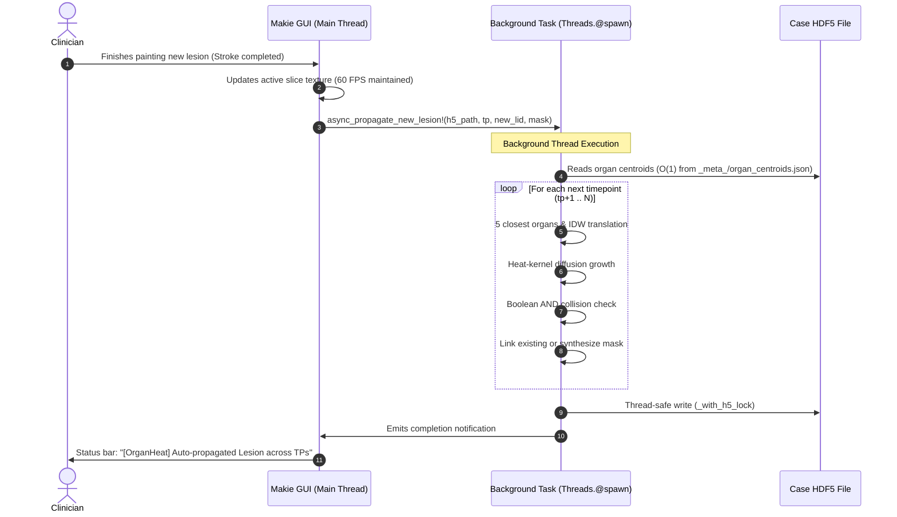

# 5-Organ Anatomical Relative Mapping & Heat-Kernel Lesion Growth

## 1. Overview & Rationale

Longitudinal tracking of metastatic lesions in oncological radioligand therapy ($^{177}\text{Lu}$-PSMA) requires consistent lesion correspondence across sequential imaging cycles ($\text{TP}_0, \text{TP}_1, \text{TP}_2, \text{TP}_3$). 

### Limitations of Legacy Mapping
1. **Rigid Spherical Placeholders**: When a responding lesion regressed or disappeared, legacy pipelines generated a constant $1343.63\text{ mm}^3$ sphere ($r \approx 6.85\text{ mm}$) centered at the baseline coordinates. These rigid spheres failed to account for patient posture changes, visceral deformations, or natural anatomical boundaries.
2. **Global Rigid Transforms**: Global rigid registration transforms (`Transform_FollowUp_to_Baseline_*.tfm`) align whole-body skeletal frames well, but local soft tissue shifts (e.g., bladder filling, bowel gas, respiratory cycle, pelvic tilt) cause localized misalignments between follow-up scans.

### The New Anatomically Guided Pipeline
The new mechanism replaces rigid spheres and global transforms with:
1. **5-Organ Local Relative Coordinates**: Anchors each lesion to its 5 closest anatomical structures from `max_anatomy` (bones, organs, lymph node stations) and translates its center to the next time point using Inverse Distance Weighting (IDW) over organ displacements.
2. **PDE-Driven Heat-Kernel Lesion Growth**: Seeds a heat diffusion partial differential equation ($\partial u / \partial t = \nabla \cdot (D \nabla u)$) inside the local edge-aware diffusivity field $D(x)$, growing the lesion until its volume matches the original tumor while naturally conforming to tissue borders and organ edges.
3. **Boolean AND Collision Detection**: Checks if an existing segmented lesion at the target timepoint overlaps with the heat-kernel region using a simple boolean AND operation. If overlapping, it links the existing lesion; if not, it commits the heat-kernel-derived segmentation as a realistic synthetic lesion.
4. **HDF5-Cached Organ Centroids**: Organ centroids are precomputed and saved directly in the case HDF5 (`_meta_/organ_centroids.json` and `ORGAN_CENTROIDS/`), allowing $O(1)$ anchor lookup.
5. **Asynchronous Background GUI Worker**: When a clinician manually paints a new lesion in the MedEye3d Makie GUI, the entire propagation across subsequent time points executes asynchronously on a background thread (`Threads.@spawn`) without dropping render frame rates.

---

## 2. Mathematical Formulation

### 2.1 5-Organ Anatomical Localization
Let $L^{(A)} \in \mathbb{R}^3$ be the 3D centroid of a lesion at timepoint $A$.

1. **Centroid Extraction**: For all anatomical labels $l \in \{1 \dots 273\}$ in `max_anatomy`:
   $$C^{(t)}(l) = \frac{1}{|V_l|} \sum_{\mathbf{x} \in V_l} \mathbf{x}$$
2. **Anchor Selection**: Find the 5 closest shared organs present in both timepoints $A$ and $B$:
   $$\mathcal{O}_5 = \arg\min_{S \subset \mathcal{L}_{A \cap B}, |S|=5} \sum_{l \in S} \| L^{(A)} - C^{(A)}(l) \|_2$$
   Let their coordinates at timepoint $A$ be $P_1 \dots P_5$ and at timepoint $B$ be $Q_1 \dots Q_5$.
3. **Inverse Distance Weighting (IDW) Translation**:
   The displacement vector of anchor organ $i$ is $\mathbf{\Delta}_i = Q_i - P_i$.
   The distance weight is:
   $$w_i = \frac{1}{\| L^{(A)} - P_i \|_2^2 + \epsilon}, \quad \epsilon = 1.0\text{ mm}$$
   $$\bar{w}_i = \frac{w_i}{\sum_{j=1}^5 w_j}$$
   $$\mathbf{\Delta}_L = \sum_{i=1}^5 \bar{w}_i \mathbf{\Delta}_i$$
   The translated lesion center at timepoint $B$ is:
   $$\mathbf{L}^{(B)} = \mathbf{L}^{(A)} + \mathbf{\Delta}_L$$

---

### 2.2 Heat-Kernel Lesion Growth & Volume Matching
At the translated coordinate $\mathbf{L}^{(B)}$:

1. **Diffusion PDE**:
   $$\frac{\partial u}{\partial t} = \nabla \cdot (D(\mathbf{x}) \nabla u)$$
   where $D(\mathbf{x}) \in [0.01, 1.0]$ is the precomputed edge-aware diffusivity field from HDF5 dataset `diffusivity`.
2. **Initial Condition**:
   $$u_0(\mathbf{c}_{\text{patch}}) = 1.0, \quad u_0(\mathbf{x} \ne \mathbf{c}_{\text{patch}}) = 0.0$$
3. **Face-Averaged Conductivity (Replicate Boundary)**:
   For adjacent voxel steps with zero-flux Neumann boundary conditions:
   $$D_{xp} = \frac{1}{2}(D(x, y, z) + D(x+1, y, z))$$
4. **Dynamic Volume Targeting (Bisection)**:
   After $K$ diffusion steps, the temperature field $u(\mathbf{x})$ decays smoothly away from the seed. The segmented volume at threshold $\theta$ is:
   $$V(\theta) = \sum_{\mathbf{x}} (u(\mathbf{x}) > \theta)$$
   Using binary search on $\theta \in [10^{-7}, \max(u)]$, we find $\theta^*$ such that $V(\theta^*) \approx V_{\text{target}}$.
5. **Morphological Cleanup**:
   $$M_{\text{heat}} = \text{ExtractLargestConnectedComponent}(u > \theta^*)$$

---

### 2.3 Boolean AND Collision Detection
To determine whether an existing follow-up lesion corresponds to the historical lesion:
1. Extract candidate labels $k_B$ in the target mask at timepoint $B$ (`PET_Lesions_B`).
2. Evaluate overlapping voxels via boolean AND:
   $$\text{OverlapCount}(k_B) = \sum_{\mathbf{x}} \big( (M_{\text{heat}}(\mathbf{x}) > 0) \ \& \ (\text{PET\_Lesions\_B}(\mathbf{x}) == k_B) \big)$$
3. **Decision Rule**:
   - If $\max_{k_B} \text{OverlapCount}(k_B) > 0$:
     - Candidate $k_B^* = \arg\max_{k_B} \text{OverlapCount}(k_B)$ is matched!
     - Link $(A, L_A) \leftrightarrow (B, k_B^*)$ with `match_type: "ORGAN_HEAT_MATCH"`.
     - Discard $M_{\text{heat}}$.
   - If all $\text{OverlapCount}(k_B) == 0$:
     - Tumor has completely responded / regressed.
     - Commit $M_{\text{heat}}$ into `PET_Lesions_B` with label ID $k_{\text{synth}}$.
     - Assign naming `artificial_heat_<ID>_PET_<B>` with `match_type: "HEAT_KERNEL_SYNTHETIC"`.

---

## 3. Data Structures & HDF5 Case Architecture

### Case HDF5 Layout (`preprocessed_volumes.h5`)
```
preprocessed_volumes.h5
├── BASELINE/
│   ├── Fixed_CT_Volume_0.nii.gz
│   ├── SUV_PET_Image_0.nii.gz
│   ├── PET_Lesions_0.nii.gz
│   ├── diffusivity                     # Float32 3D edge diffusivity
│   └── max_anatomy.nii.gz              # UInt16 3D anatomical labels (1..273)
├── TFM_Transform_FollowUp_to_Baseline_1.tfm/
│   ├── Fixed_CT_Volume_1.nii.gz
│   ├── SUV_PET_Image_1.nii.gz
│   ├── PET_Lesions_1.nii.gz            # Updated with HEAT_KERNEL_SYNTHETIC
│   ├── diffusivity
│   └── max_anatomy.nii.gz
├── ORGAN_CENTROIDS/                    # Dedicated fast lookup datasets
│   ├── tp0_lid1 -> Float32[x, y, z]
│   ├── tp0_lid2 -> Float32[x, y, z]
│   └── ...
├── CENTROIDS/                          # Lesion & synthetic centroids
│   ├── tp0_lid18 -> Int32[x, y, z]
│   └── ...
└── _meta_/
    ├── organ_centroids.json            # Full JSON dict of all organ centroids
    ├── matches.json                    # Serialized MATCH_GROUPS
    └── lesion_annotations.json
```

---

## 4. Asynchronous GUI Execution on Manual Lesion Creation

When a user draws a new lesion or modifies an existing lesion in the MedEye3d Makie viewer:



---

## 5. Preprocessing Ingestion for XNAT Cases

The pipeline is fully integrated into the batch preprocessing tools:
- [`scripts/preprocessing/preprocess_dataset.jl`](file:///workspaces/MedEye3d.jl/scripts/preprocessing/preprocess_dataset.jl):
  - Precalculates `compute_organ_centroids` immediately following `max_anatomy` generation.
  - Automatically runs `propagate_all_timepoints!` on all downloaded clinical lesions.
- [`scripts/xnat/xnat_preprocess_case.sh`](file:///workspaces/MedEye3d.jl/scripts/xnat/xnat_preprocess_case.sh):
  - Ingests DICOMs from XNAT, runs registration, segmentations, and organ-heat lesion tracking in headless batch mode.
  - Prepares ready-to-open HDF5 cases for clinicians.
